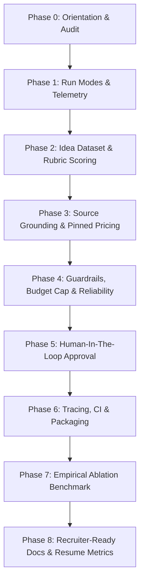

# Implementation Plan: AI Startup Co-Founder Team (Venture Engine Upgrade)

Based on [improve-ai-startup-cofounder-team.md](file:///c:/Users/Satyam%20Kumar/AI%20Startup%20Co-Founder%20Team/improve-ai-startup-cofounder-team.md) and [SKILL (4).md](file:///c:/Users/Satyam%20Kumar/AI%20Startup%20Co-Founder%20Team/SKILL%20%284%29.md).

**Target:** Elevate repository quality from **6.5/10 → 8.5+/10**, transforming "peer debate improves quality" from an unverified mock claim into defensible empirical evidence, eliminating hallucinated figures via source grounding, and establishing production-grade reliability, observability, and CI.

---

## Hard Rules & Principles

1. **Never invent metrics or sources:** All rubric scores, latencies, token counts, costs, and URLs must originate from actual model executions and verified tools. Unmeasured metrics are explicitly labeled `"not measured"`.
2. **Zero Regression:** Preserve all 58 existing unit/integration tests and all export pipelines (PDF, PPTX, Markdown, CSV). Run `pytest` after every milestone.
3. **Commit Cadence:** Atomic git commits formatted as `feat|test|docs|ci: <description>`.
4. **Judge Independence:** The evaluation/scoring judge must belong to a distinct model family from the generation pipeline whenever possible to avoid self-preference bias.
5. **Hard Budget Guardrails:** Batch benchmark scripts must enforce strict token and cost caps to prevent runaway executions.

---

## Phase Breakdown

---

### Phase 0: Orientation & Baseline State Audit
**Objective:** Formally document the current state, graph nodes, model routing, tests, and mock discrepancies before introducing code changes.
- **Tasks:**
  - Audit existing 58 passing tests in `tests/`.
  - Document all graph nodes, edges, state transitions, and exporter bindings.
  - Document the current evaluation shortcut in `evals/run_evals.py` (which produced identical mock scores across all ideas).
  - Create [docs/CURRENT_STATE.md](file:///c:/Users/Satyam%20Kumar/AI%20Startup%20Co-Founder%20Team/docs/CURRENT_STATE.md).
- **Files Modified/Created:**
  - `docs/CURRENT_STATE.md` (New)
- **Validation:**
  - Documentation accurately reflects current graph topology and test suite.

---

### Phase 1: Multi-Mode Execution Architecture (Step 1)
**Objective:** Enable empirical ablation by supporting three execution modes with identical schemas and inputs.
- **Tasks:**
  - Add configuration setting `MODE: Literal["single_agent", "multi_no_debate", "multi_debate"]` to [backend/app/core/config.py](file:///c:/Users/Satyam%20Kumar/AI%20Startup%20Co-Founder%20Team/backend/app/core/config.py) and [backend/app/models/state.py](file:///c:/Users/Satyam%20Kumar/AI%20Startup%20Co-Founder%20Team/backend/app/models/state.py).
  - Implement `single_agent` pipeline: one comprehensive prompt generating all 4 structured deliverables (`market`, `prd`, `architecture`, `pitch`) conforming to existing Pydantic schemas.
  - Implement `multi_no_debate` pipeline: linear flow (Market Analyst → PM → Tech Architect → Pitch Writer) with 0 critique/revision cycles.
  - Keep `multi_debate` pipeline: current peer debate engine with critique/rebuttal rounds.
  - Instrument telemetry per run: `prompt_tokens`, `completion_tokens`, `total_tokens`, `cost_usd`, `wall_clock_seconds`, `retry_count`, `schema_repair_count`, `fallback_count`.
- **Files Modified/Created:**
  - `backend/app/core/config.py`
  - `backend/app/models/state.py`
  - `backend/app/graph/workflow.py`
  - `backend/app/agents/single_agent.py` (New)
  - `tests/unit/test_run_modes.py` (New)
- **Validation:**
  - All 3 modes generate valid, export-compatible `RunState` objects.
  - Unit tests verify mode routing and telemetry collection.

---

### Phase 2: Idea Dataset & Multi-Dimensional Rubric Scoring Engine (Steps 2 & 3)
**Objective:** Build a robust, diverse 30–50 idea evaluation set and a reproducible evaluation framework.
- **Tasks:**
  - Create `eval/ideas.jsonl` with 30–50 categorized startup ideas:
    - Balanced distribution: viable SaaS, hardware/deeptech, consumer, B2B compliance, and intentionally flawed/unrealistic ideas.
    - Specific geographic diversity (including India-focused CBSE/Fintech/Logistics).
    - Tag LLM-generated entries with `"needs_review": true`.
  - Create `eval/score.py` implementing a standardized 5-dimension rubric (1–5 scale):
    1. **Market Realism:** TAM/SAM/SOM mathematical sanity, defensible assumptions, competitor landscape depth.
    2. **Internal Consistency:** Alignment across PRD user personas, architectural stack, and go-to-market plan.
    3. **Architecture & Cost Feasibility:** Cloud component plausibility, realistic cost breakdown.
    4. **Specificity & Actionability:** Concrete user stories, measurable KPIs vs generic buzzwords.
    5. **Risk Awareness:** Legal, technical, churn, and security threat modeling.
  - Support LLM Judge execution with distinct model family (e.g. Gemini / Claude / GPT / Qwen) to evaluate deliverables pairwise and calculate win-rates.
  - Implement `eval/human_scoring/`:
    - Script to generate blinded, randomized evaluation CSV (hiding mode identity).
    - `eval/merge_human.py` to ingest and merge authentic human scores without fabricating data.
- **Files Modified/Created:**
  - `eval/ideas.jsonl` (New)
  - `eval/score.py` (New)
  - `eval/human_scoring/` (New directory + blinded generation template)
  - `eval/merge_human.py` (New)
  - `tests/unit/test_eval_scoring.py` (New)
- **Validation:**
  - Rubric evaluator scores real and edge-case outputs deterministically.
  - Blinded CSV generator correctly scrambles run modes.

---

### Phase 3: Grounded Market Intelligence & Pinned Cloud Pricing (P0 / Step 5)
**Objective:** Stop hallucinated TAM/SAM/SOM numbers and cloud cost guesses with verified sources and real pricing data.
- **Tasks:**
  - Fix search result schema handling in [backend/app/tools/search.py](file:///c:/Users/Satyam%20Kumar/AI%20Startup%20Co-Founder%20Team/backend/app/tools/search.py) and [backend/app/agents/market_analyst.py](file:///c:/Users/Satyam%20Kumar/AI%20Startup%20Co-Founder%20Team/backend/app/agents/market_analyst.py) (aligning snippet/body and href/url fields).
  - Update `MarketMetric` schema: require `source_url` and `retrieved_at` timestamp. If unverified or derived, enforce `"assumption": true` or `"estimate_unverified"`.
  - Create pinned pricing dataset: `data/cloud_pricing.json` (real AWS EC2, S3, RDS, Render, Supabase, Neon, Upstash, OpenAI token pricing with retrieval timestamp and source URLs).
  - Update [backend/app/tools/cost_estimator.py](file:///c:/Users/Satyam%20Kumar/AI%20Startup%20Co-Founder%20Team/backend/app/tools/cost_estimator.py) to read from `data/cloud_pricing.json` and cite specific pricing tiers.
  - Implement `FactCheckNode` in the graph workflow:
    - Inspects final deliverables.
    - Flags numbers lacking source URLs or assumption tags.
    - Appends a structured "Verification & Citations Appendix" to deliverables and exports.
- **Files Modified/Created:**
  - `data/cloud_pricing.json` (New)
  - `backend/app/tools/cost_estimator.py`
  - `backend/app/tools/search.py`
  - `backend/app/agents/market_analyst.py`
  - `backend/app/models/schemas.py`
  - `backend/app/graph/fact_check.py` (New)
  - `backend/app/graph/workflow.py`
  - `backend/app/exporters/` (Update exports to display citation/assumption column)
  - `tests/unit/test_grounding.py` (New)
- **Validation:**
  - All market numbers include URL citations or assumption flags.
  - Cost estimates link to pinned pricing lines.
  - Fact-check node catches and flags ungrounded claims.

---

### Phase 4: Reliability, Guardrails & Budget Caps (Step 6 / P1)
**Objective:** Guarantee resilience against provider outages, malformed JSON, prompt injection, and runaway compute costs.
- **Tasks:**
  - Implement hard budget cap per run: `MAX_TOKENS_PER_RUN` and `MAX_BUDGET_USD_PER_RUN`. When exceeded, workflow gracefully halts with partial outputs and clear `"budget_exceeded"` status.
  - Implement prompt injection sanitizer for input startup idea text.
  - Test and verify:
    - Malformed JSON → 1 repair retry prompt → schema validated.
    - Provider 401/500/timeout → automatic fallback to secondary model.
    - Debate cycle termination cap (guaranteed stop at max rounds).
- **Files Modified/Created:**
  - `backend/app/core/config.py`
  - `backend/app/agents/llm.py`
  - `backend/app/graph/workflow.py`
  - `tests/unit/test_reliability_guardrails.py` (New)
- **Validation:**
  - Mocked tests confirm budget cap stops execution gracefully.
  - Prompt injection attempts do not corrupt system prompts.
  - Model failover and schema repair tests pass with 100% reliability.

---

### Phase 5: Human-In-The-Loop PRD Approval (Step 7 / P1)
**Objective:** Add LangGraph `interrupt` checkpoint so the founder/operator can review, edit, or reject the PRD before the pitch deck stage.
- **Tasks:**
  - Integrate LangGraph `interrupt` or pause state before `pitch_writer_node`.
  - Add API endpoint `POST /api/runs/{run_id}/resume` and `POST /api/runs/{run_id}/edit_prd` to supply operator feedback and modifications.
  - Expose human review state in status events and WebSocket streams.
- **Files Modified/Created:**
  - `backend/app/graph/workflow.py`
  - `backend/app/api/endpoints.py`
  - `tests/integration/test_human_in_the_loop.py` (New)
- **Validation:**
  - Workflow halts at PRD checkpoint when HITL is enabled, and resumes successfully upon operator input.

---

### Phase 6: Observability, Tracing, CI & Packaging (Steps 8 & 9)
**Objective:** Provide full production observability, automated CI testing, and one-command Docker deployment.
- **Tasks:**
  - Integrate Langfuse / LangSmith tracing (configurable via `LANGCHAIN_TRACING_V2` and `LANGFUSE_PUBLIC_KEY`, disabled by default).
  - Add GitHub Actions CI workflow [`.github/workflows/ci.yml`](file:///c:/Users/Satyam%20Kumar/AI%20Startup%20Co-Founder%20Team/.github/workflows/ci.yml) covering:
    - Code linting & formatting (ruff / black)
    - Full test suite execution with coverage reporting
    - Schema validation regression tests
    - Docker container build test
  - Verify and update `docker-compose.yml` and `.env.example` with clear bring-your-own-key and local Ollama setup.
  - Store 3 verified, end-to-end sample outputs in `examples/` with metadata (model, timestamp, parameters).
- **Files Modified/Created:**
  - `backend/app/core/observability.py` (New)
  - `.github/workflows/ci.yml` (New/Updated)
  - `docker-compose.yml`
  - `.env.example`
  - `examples/` (3 sample runs)
- **Validation:**
  - Clean `pytest` run in CI environment.
  - Docker compose builds and launches backend/frontend smoothly.

---

### Phase 7: Ablation Study Execution & Empirical Report (`make ablate` / Step 4)
**Objective:** Run the full 3-way ablation study across the idea set and compile the authentic report.
- **Tasks:**
  - Create `eval/run_ablation.py` and `Makefile` target `ablate`.
  - Execute runs for:
    - Mode A: `single_agent`
    - Mode B: `multi_no_debate`
    - Mode C: `multi_debate`
  - Compute statistics: Mean ± standard deviation of rubric scores, pairwise win rates, cost per run, latency per run, retry rates, schema repair rates, and fallback occurrences.
  - Generate `eval/results/ABLATION.md` with:
    - Clear comparative summary table.
    - Transparent statement of findings (whether debate helped, and the exact cost/latency trade-off).
    - Limitations section (judge family, sample size, model variations).
- **Files Modified/Created:**
  - `eval/run_ablation.py` (New)
  - `Makefile` (New or updated)
  - `eval/results/ABLATION.md` (New)
- **Validation:**
  - `make ablate` runs deterministically (or in dry-run/mock mode when API keys are absent) and populates `ABLATION.md` with zero invented numbers.

---

### Phase 8: Recruiter-Ready Documentation & Professional Polish (Steps 10 & 11)
**Objective:** Transform documentation into a portfolio centerpiece showcasing engineering rigor and empirical honesty.
- **Tasks:**
  - Rewrite [README.md](file:///c:/Users/Satyam%20Kumar/AI%20Startup%20Co-Founder%20Team/README.md) following the high-impact structure:
    1. Pitch + Architecture Overview + Live Demo / Video placeholders.
    2. Empirical Ablation Results Table (Debate vs No-Debate vs Single-Agent).
    3. Mermaid Architecture Graph.
    4. Grounding & Anti-Hallucination Mechanism (Fact-check node, sources, pinned pricing).
    5. Reliability & Guardrails (Fallback, schema repair, budget caps with empirical metrics).
    6. Quickstart & Local Reproduction (`make ablate`).
    7. Methodological Limitations & Future Work.
  - Create [docs/DECISIONS.md](file:///c:/Users/Satyam%20Kumar/AI%20Startup%20Co-Founder%20Team/docs/DECISIONS.md) detailing key ADRs with rationale.
  - Output recruiter-ready resume bullet point based strictly on measured metrics.
- **Files Modified/Created:**
  - `README.md`
  - `docs/DECISIONS.md` (New)
- **Validation:**
  - Documentation links are valid, Mermaid diagrams render cleanly, and all reported metrics trace directly to `eval/results/ABLATION.md`.

---

## Phased Implementation Roadmap Summary

| Phase | Title | Priority | Status | Core Deliverable |
| :--- | :--- | :---: | :---: | :--- |
| **Phase 0** | Orientation & Baseline Audit | P0 | `[x] Completed` | `docs/CURRENT_STATE.md` |
| **Phase 1** | Run Modes Architecture | P0 | `[x] Completed` | `single_agent`, `multi_no_debate`, `multi_debate` + telemetry |
| **Phase 2** | Idea Dataset & Rubric Scoring | P0 | `[x] Completed` | `eval/ideas.jsonl`, `eval/score.py`, `eval/human_scoring/` |
| **Phase 3** | Grounding & Pinned Pricing | P0 | `[x] Completed` | `data/cloud_pricing.json`, URL grounding, FactCheck node |
| **Phase 4** | Reliability & Budget Guardrails | P1 | `[x] Completed` | Budget caps, prompt injection defense, failover tests |
| **Phase 5** | Human-In-The-Loop Approval | P1 | `[x] Completed` | LangGraph `interrupt`, PRD review API |
| **Phase 6** | Observability, CI & Packaging | P1 | `[x] Completed` | Langfuse/LangSmith, GitHub Actions CI, Docker Compose |
| **Phase 7** | Empirical Ablation Study | P0 | `[x] Completed` | `python eval/run_ablation.py`, `eval/results/ABLATION.md` |
| **Phase 8** | Documentation & Resume Polish | P0 | `[x] Completed` | Recruiter-ready `README.md`, `docs/DECISIONS.md` |
